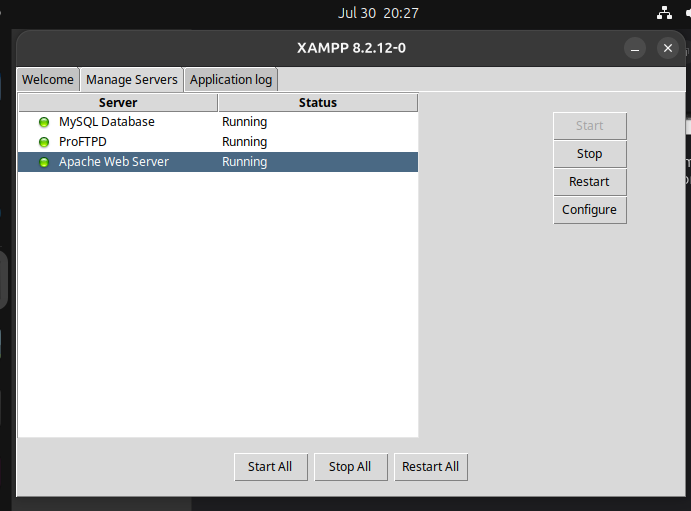
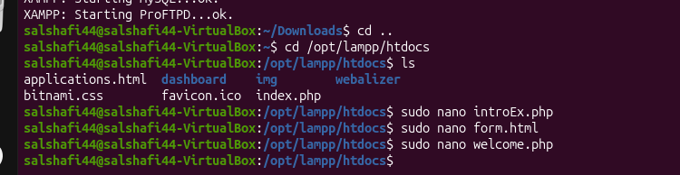
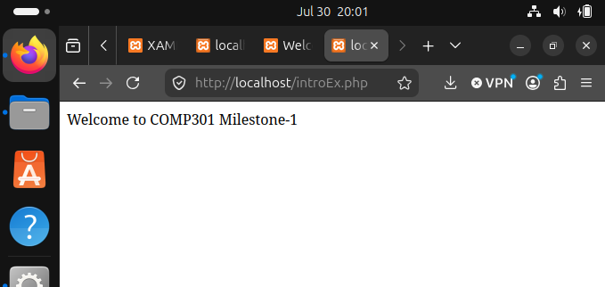
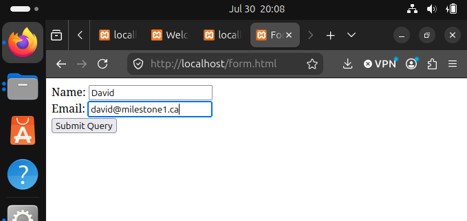
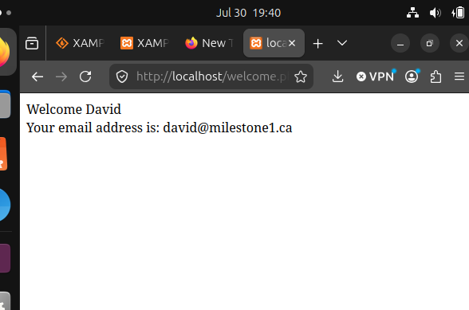
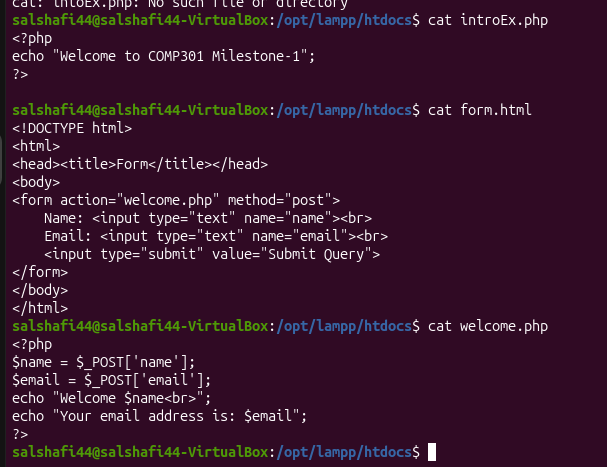

# Milestone 1 - XAMPP / LAMP on Ubuntu

The goal was to get a working web server with PHP running and confirm it by loading pages in the browser.

## What I did

1. Installed XAMPP on Ubuntu and started Apache from the XAMPP control script.
2. Put my files in the `htdocs` folder (that's the folder Apache serves).
3. Opened `http://localhost/introEx.php` to check PHP was running.
4. Opened `http://localhost/form.html`, filled in a name and email, and submitted. That sends a POST request to `welcome.php`, which prints the values back.

## Screenshots

XAMPP control panel with Apache, MySQL and ProFTPD running:

Project files created in the htdocs folder:

`introEx.php` in the browser:

The form filled in:

The result after submitting:

The source of the three files (`cat` in the terminal):

## Files

| File | What it does |
|------|--------------|
| `introEx.php` | Prints one line to confirm PHP works |
| `form.html` | Simple form with name and email fields, posts to `welcome.php` |
| `welcome.php` | Reads the two values from `$_POST` and echoes them |

## Notes

- `welcome.php` prints whatever the user typed straight back out. That is fine for a class exercise, but in anything real the values should be escaped first (for example with `htmlspecialchars()`), otherwise someone could put HTML or script in the name field. I haven't added that here because I wanted to keep the file as I submitted it.
- There is also no check for empty fields.
