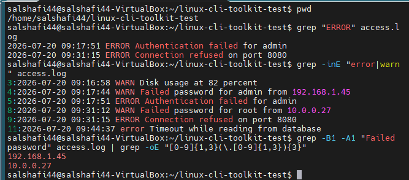
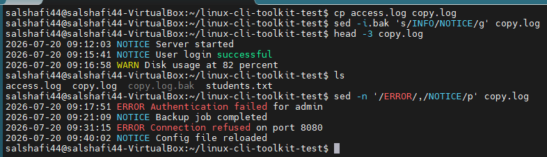
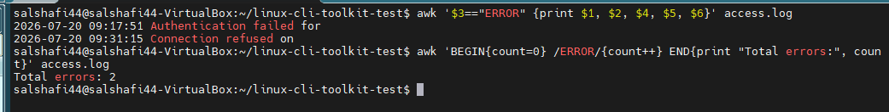
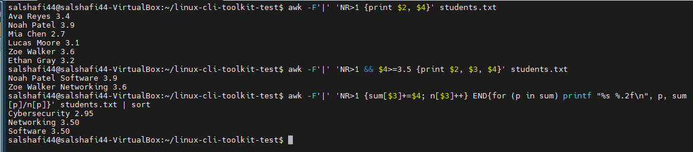

# Milestone 2 - grep, sed, find, awk and cron

Practice with the main text tools. I made two small files to run them on:

- `access.log` - a fake 12-line log with INFO / WARN / ERROR lines
- `students.txt` - pipe-separated data: `ID|Name|Program|GPA` (the names are made up)

Everything below was run on those two files and the output is copied from the terminal.

## grep

Find lines with ERROR:
```
$ grep "ERROR" access.log
2026-07-20 09:17:51 ERROR Authentication failed for admin
2026-07-20 09:31:15 ERROR Connection refused on port 8080
```

Case-insensitive, extended regex, with line numbers (`-i` also catches the lowercase `error` line):
```
$ grep -inE "error|warn" access.log
3:2026-07-20 09:16:58 WARN Disk usage at 82 percent
4:2026-07-20 09:17:44 WARN Failed password for admin from 192.168.1.45
5:2026-07-20 09:17:51 ERROR Authentication failed for admin
8:2026-07-20 09:31:12 WARN Failed password for root from 10.0.0.27
9:2026-07-20 09:31:15 ERROR Connection refused on port 8080
11:2026-07-20 09:44:37 error Timeout while reading from database
```

Pull just the IP addresses out of failed-login lines (`-B1 -A1` shows a line before and after, `-o` prints only the matching part):
```
$ grep -B1 -A1 "Failed password" access.log | grep -oE "[0-9]{1,3}(\.[0-9]{1,3}){3}"
192.168.1.45
10.0.0.27
```



## sed

I ran sed on a copy so the original `access.log` still has INFO in it. `-i.bak` edits the file in place and saves the original as `copy.log.bak`:
```
$ cp access.log copy.log
$ sed -i.bak 's/INFO/NOTICE/g' copy.log
$ head -3 copy.log
2026-07-20 09:12:03 NOTICE Server started
2026-07-20 09:15:41 NOTICE User login successful
2026-07-20 09:16:58 WARN Disk usage at 82 percent
```

Print from each ERROR line down to the next NOTICE line:
```
$ sed -n '/ERROR/,/NOTICE/p' copy.log
2026-07-20 09:17:51 ERROR Authentication failed for admin
2026-07-20 09:21:09 NOTICE Backup job completed
2026-07-20 09:31:15 ERROR Connection refused on port 8080
2026-07-20 09:40:02 NOTICE Config file reloaded
```



## find

```
find /path -name "*.txt"                 # by name
find /path -type f -name "*.sh"          # regular files only, by extension
find /path -type f -exec ls -la {} \;    # run a command on every result
```

For `-exec`, `{}` is where the filename goes and `\;` ends the command. I typed `[]` instead of `{}` the first time and it didn't work, so double-check that one.

## awk

Print the third field (the log level):
```
$ awk '{print $3}' access.log
```

Only ERROR lines, picking certain fields:
```
$ awk '$3=="ERROR" {print $1, $2, $4, $5, $6}' access.log
2026-07-20 09:17:51 Authentication failed for
2026-07-20 09:31:15 Connection refused on
```

Count errors using BEGIN / END:
```
$ awk 'BEGIN{count=0} /ERROR/{count++} END{print "Total errors:", count}' access.log
Total errors: 2
```
Note that it only counts uppercase `ERROR`, so the lowercase `error` line is not included.



For the pipe-delimited file I use `-F'|'` to set the separator, and `NR>1` to skip the header row.

Names and GPAs:
```
$ awk -F'|' 'NR>1 {print $2, $4}' students.txt
Ava Reyes 3.4
Noah Patel 3.9
Mia Chen 2.7
Lucas Moore 3.1
Zoe Walker 3.6
Ethan Gray 3.2
```

Students with GPA 3.5 or higher:
```
$ awk -F'|' 'NR>1 && $4>=3.5 {print $2, $3, $4}' students.txt
Noah Patel Software 3.9
Zoe Walker Networking 3.6
```

Average GPA per program (uses an associative array):
```
$ awk -F'|' 'NR>1 {sum[$3]+=$4; n[$3]++} END{for (p in sum) printf "%s %.2f\n", p, sum[p]/n[p]}' students.txt | sort
Cybersecurity 2.95
Networking 3.50
Software 3.50
```



## cron

Edit the crontab without wiping what's already there:
```
crontab -l 2>/dev/null > mycron.txt
echo "*/5 * * * * echo 'cron test' >> ~/ms2/cron_test.log" >> mycron.txt
crontab mycron.txt
```

The five fields are minute, hour, day of month, month, day of week. `*/5` in the first field means every 5 minutes, so this appends "cron test" to `cron_test.log` every five minutes. I checked it by looking at the log file after a few minutes.
